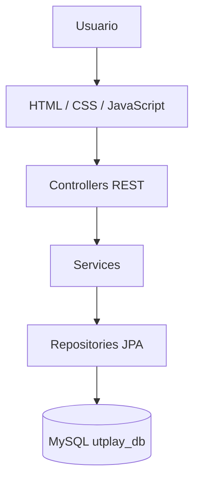

# UTPlay

Sistema web de repaso académico para estudiantes de Ingeniería de Sistemas de la UTP Chiclayo. Permite registrar estudiantes, iniciar sesión, consultar cursos, validar prerrequisitos, resolver quizzes, acumular puntos, subir de nivel, obtener logros y visualizar el progreso académico.

> Los cursos y preguntas incluidos son datos de demostración editables; no pretenden sustituir la malla curricular oficial de la universidad.

## Tecnologías

- Java 17 y Spring Boot 3.5.16
- Spring Web, Spring Data JPA, Spring Security y Bean Validation
- JWT para autenticación y BCrypt para contraseñas
- MySQL 8
- HTML5, CSS3 y JavaScript sin frameworks
- Maven

## Arquitectura



El backend se separa en `controller`, `service`, `repository`, `model`, `dto`, `security`, `config` y `exception`. El frontend se sirve desde `src/main/resources/static`, por lo que funciona en el mismo puerto que la API.

## Puesta en marcha

### Requisitos

1. JDK 17.
2. Maven 3.6.3 o superior.
3. MySQL 8.0 o superior.

### 1. Crear la base de datos

Abra MySQL Workbench, seleccione **File > Open SQL Script**, abra `database/utplay_db.sql` y ejecute todo el archivo con el botón del rayo. El script:

- crea `utplay_db`;
- crea las siete tablas, relaciones, restricciones e índices;
- inserta cinco logros;
- inserta seis cursos, seis quizzes y dieciocho preguntas de demostración.

También puede ejecutarlo desde una terminal:

```bash
mysql -u root -p < database/utplay_db.sql
```

### 2. Configurar la conexión

Los valores locales predeterminados están en `src/main/resources/application.properties`:

```properties
DB_URL=jdbc:mysql://localhost:3306/utplay_db
DB_USER=root
DB_PASSWORD=root
```

Si su contraseña de MySQL no es `root`, defínala sin modificar el código:

PowerShell:

```powershell
$env:DB_PASSWORD="SU_CLAVE_MYSQL"
$env:JWT_SECRET="una-clave-aleatoria-de-al-menos-32-caracteres"
mvn spring-boot:run
```

Linux o macOS:

```bash
export DB_PASSWORD='SU_CLAVE_MYSQL'
export JWT_SECRET='una-clave-aleatoria-de-al-menos-32-caracteres'
mvn spring-boot:run
```

### 3. Ejecutar

Desde la carpeta `UTPlay`:

```bash
mvn clean spring-boot:run
```

Abra [http://localhost:8080](http://localhost:8080). Cree una cuenta desde la página de registro; el script no inserta una contraseña de demostración.

### Alternativa con Docker para MySQL

```bash
docker compose up -d
mvn spring-boot:run
```

El contenedor usa `root` como contraseña local y ejecuta automáticamente el script SQL la primera vez. No use esa clave en producción.

## Endpoints

Todos los endpoints, excepto registro y login, requieren `Authorization: Bearer <token>`.

| Método | Ruta | Función |
|---|---|---|
| POST | `/usuarios/registrar` | Registrar estudiante |
| POST | `/usuarios/login` | Autenticar y entregar JWT |
| GET | `/usuarios/{id}` | Consultar perfil propio |
| PUT | `/usuarios/{id}` | Actualizar nombre y ciclo |
| GET | `/cursos` | Listar cursos y disponibilidad |
| GET | `/cursos/ciclo/{numero}` | Filtrar cursos por ciclo |
| GET | `/quiz/{id}` | Mostrar quiz sin revelar respuestas |
| POST | `/quiz/resolver` | Corregir, puntuar y guardar un intento |
| GET | `/resultados/{usuario}` | Historial y progreso del usuario |
| GET | `/gamificacion/{usuario}` | Puntos, nivel y logros |

Ejemplo de registro:

```json
{
  "nombre": "Andrea Torres Ruiz",
  "correo": "andrea.torres@utp.edu.pe",
  "password": "ClaveSegura123",
  "cicloActual": 3
}
```

Ejemplo para resolver un quiz:

```json
{
  "idQuiz": 1,
  "respuestas": [
    { "idPregunta": 1, "alternativa": "B" },
    { "idPregunta": 2, "alternativa": "A" },
    { "idPregunta": 3, "alternativa": "C" }
  ]
}
```

## Reglas implementadas

- El correo es único y se normaliza en minúsculas.
- La contraseña exige entre 8 y 72 caracteres y se guarda con BCrypt.
- Un curso se bloquea si pertenece a un ciclo superior al del estudiante.
- Un prerrequisito se considera aprobado cuando existe un resultado aprobado en alguno de sus quizzes.
- Cada quiz se califica de 0 a 100; el mínimo inicial es 60.
- El puntaje obtenido se convierte en puntos; un resultado perfecto recibe 20 puntos extra.
- Repetir un quiz solo entrega la diferencia positiva respecto del mejor intento anterior. Así no se pueden acumular puntos repitiendo respuestas ya dominadas.
- Se sube un nivel cada 500 puntos.
- Los logros se entregan automáticamente al alcanzar su umbral.
- Cada usuario solo puede leer o modificar sus propios datos.

## Cambios necesarios realizados en la base de datos

No se agregó ninguna tabla fuera de las siete solicitadas. Sí se normalizaron y añadieron estos campos para que los módulos funcionen correctamente:

| Tabla | Campo añadido o ajustado | Motivo |
|---|---|---|
| `usuario` | `puntos_totales`, `nivel` | Mantener el estado de gamificación sin recalcular todo el historial en cada petición |
| `curso` | `descripcion` | Mostrar información útil en las tarjetas del frontend |
| `curso` | `id_prerrequisito` en lugar de texto libre | Convertir el prerrequisito en una FK autorreferenciada válida |
| `curso` | `activo` | Ocultar cursos sin eliminar su historial |
| `quiz` | `puntaje_minimo` | Determinar de forma configurable cuándo se aprueba |
| `quiz` | `activo` | Retirar temporalmente un quiz sin borrar resultados |
| `resultado` | `respuestas_correctas`, `total_preguntas` | Mostrar un resultado comprensible y auditable |
| `resultado` | `puntos_ganados` | Registrar cuántos puntos aportó cada intento |

También se añadieron restricciones `CHECK`, claves únicas e índices para integridad y mejor rendimiento. La tabla `usuario_logro` usa clave primaria compuesta para impedir que el mismo logro se asigne dos veces al mismo estudiante.

## Pruebas

Ejecute:

```bash
mvn test
```

Las pruebas automatizadas cubren registro, login correcto, contraseña incorrecta, corrección del quiz, cálculo del puntaje, persistencia del resultado y prevención de puntos duplicados. Consulte `docs/PRUEBAS.md` para los casos manuales y `postman/UTPlay.postman_collection.json` para probar la API.

## Estructura principal

```text
UTPlay/
├── database/utplay_db.sql
├── docs/
├── postman/
├── src/main/java/com/utplay/
│   ├── config/
│   ├── controller/
│   ├── dto/
│   ├── exception/
│   ├── model/
│   ├── repository/
│   ├── security/
│   └── service/
├── src/main/resources/static/
│   ├── css/app.css
│   ├── js/
│   └── *.html
├── src/test/
├── docker-compose.yml
└── pom.xml
```

## Seguridad antes de publicar

- Cambie `JWT_SECRET` por un valor aleatorio largo y no lo suba al repositorio.
- Use HTTPS.
- Cree un usuario MySQL exclusivo con permisos solo sobre `utplay_db`.
- Cambie las credenciales del archivo `docker-compose.yml` si se usa fuera de una computadora local.
- Para una versión institucional, considere JWT en cookie `HttpOnly`, recuperación de contraseña y verificación del correo universitario.
