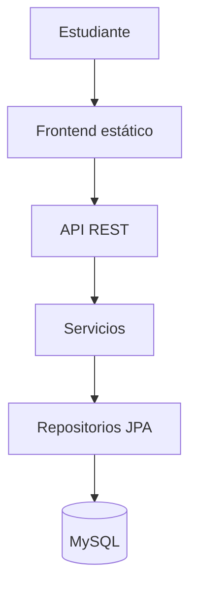
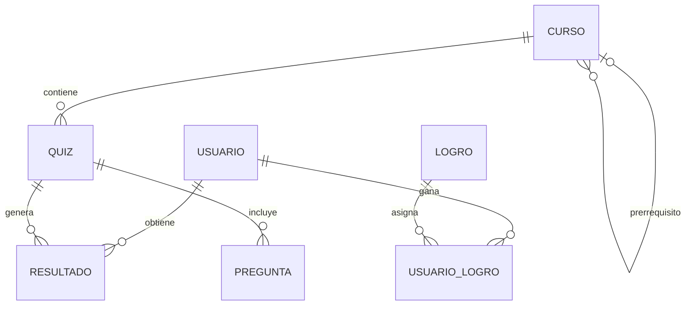
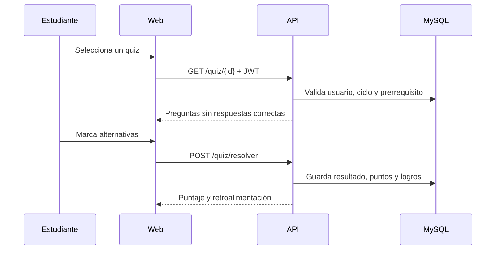

# UTPlay — análisis y diseño del sistema

## 1. Problema y objetivo

Los estudiantes requieren una forma breve y organizada de reforzar conocimientos de la carrera, reconocer qué cursos pueden practicar y observar su avance. UTPlay propone una plataforma web que integra repaso, evaluación y gamificación.

El objetivo general es desarrollar un sistema web funcional donde un estudiante pueda registrarse, autenticarse, seleccionar cursos habilitados, resolver quizzes, obtener puntajes y logros, y consultar su progreso académico.

## 2. Alcance funcional

### Actor principal

**Estudiante:** crea una cuenta, inicia sesión, actualiza su perfil, explora cursos, resuelve quizzes y consulta resultados.

### Casos de uso

| Código | Caso de uso | Resultado esperado |
|---|---|---|
| CU-01 | Registrar estudiante | Se crea una cuenta con contraseña cifrada |
| CU-02 | Iniciar sesión | Se entrega un token JWT válido |
| CU-03 | Consultar/actualizar perfil | Se muestran o actualizan únicamente los datos propios |
| CU-04 | Consultar cursos | Se listan cursos con estado disponible o bloqueado |
| CU-05 | Filtrar por ciclo | Se muestran los cursos del ciclo elegido |
| CU-06 | Resolver quiz | Se validan todas las respuestas y se calcula el puntaje |
| CU-07 | Consultar historial | Se muestran intentos, fechas, puntajes y aprobación |
| CU-08 | Progresar | Se actualizan puntos, nivel y logros automáticamente |

## 3. Arquitectura

Responsabilidades por capa:

| Capa | Responsabilidad |
|---|---|
| Frontend | Formularios, navegación, consumo de API y representación del progreso |
| Controller | Rutas HTTP, validación de entrada y códigos de respuesta |
| Service | Reglas de negocio, seguridad por propietario y transacciones |
| Repository | Consultas y persistencia mediante Spring Data JPA |
| Model | Mapeo de entidades y relaciones de la base de datos |
| DTO | Contratos de entrada/salida; evita exponer entidades y contraseñas |
| Security | Validación JWT, BCrypt, CORS y control de acceso |

## 4. Modelo de datos

### Relaciones

- Un curso contiene muchos quizzes.
- Un quiz contiene muchas preguntas.
- Un usuario registra muchos resultados y un quiz puede tener muchos resultados.
- Usuario y logro mantienen una relación muchos a muchos mediante `usuario_logro`.
- Un curso puede tener un curso como prerrequisito.

### Integridad

- `correo`, `nombre_curso`, `titulo` de quiz y nombre de logro son únicos.
- Las FK impiden preguntas sin quiz y resultados sin usuario o quiz.
- El ciclo se limita al intervalo 1–10.
- Los puntajes se limitan a 0–100.
- La respuesta correcta solo admite A, B, C o D.
- La PK compuesta de `usuario_logro` impide duplicados.

## 5. Flujo para resolver un quiz

## 6. Requisitos no funcionales

- **Seguridad:** contraseñas BCrypt, autenticación JWT, autorización por propietario y DTO sin password.
- **Integridad:** transacciones en operaciones que guardan resultado, puntos y logros.
- **Usabilidad:** interfaz responsiva, mensajes de error claros y estados de carga.
- **Mantenibilidad:** capas separadas y configuración por variables de entorno.
- **Compatibilidad:** navegador moderno, Java 17 y MySQL 8.
- **Rendimiento inicial:** índices en FK y consultas frecuentes de resultados.

## 7. Decisiones de diseño

1. El campo `prerrequisito` se modeló como `id_prerrequisito`, una FK autorreferenciada. Un texto libre no permitiría validar el curso de manera confiable.
2. Se guardan puntos y nivel en `usuario` para que el dashboard no tenga que sumar todos los intentos en cada carga.
3. Se mantiene cada intento en `resultado`, pero solo una mejora del mejor puntaje suma puntos.
4. El backend no entrega `respuesta_correcta` al solicitar un quiz; esa información solo aparece después de corregirlo.
5. El frontend se integra en el mismo proyecto Spring Boot para simplificar ejecución, CORS y entrega académica.

## 8. Trabajo futuro opcional

- Panel administrativo para gestionar cursos, quizzes y preguntas.
- Recuperación y cambio de contraseña.
- Verificación de correo institucional.
- Preguntas aleatorias, límite de tiempo y bancos por dificultad.
- Ranking por ciclo con reglas de privacidad.
- Reportes descargables para docentes.
